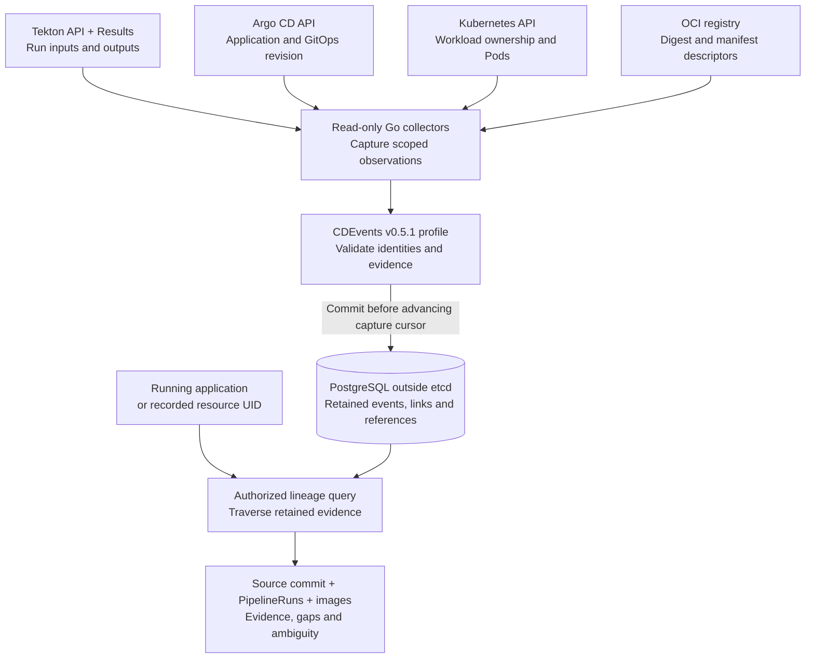

# ADR-0008: Tekton-to-Argo deployment lineage

## Context

> Can we determine the source commit, Tekton PipelineRuns, and container image built from that, for a currently running application on Kubernetes, after the original Kubernetes resources are deleted?

OpenShift Pipelines requires an end-to-end connection between Tekton build evidence and Argo CD deployments, and also between Argo CD deployments and the containers actually observed running. The source, GitOps and image identities describe different sets of data. The existing APIs and independently pruned archives do not describe that end-to-end history.

This answer is conditionally proposed. Facts must be collected before they disappear. Afterward, they may be retained and queried independently. History that has not been collected cannot be recovered. A missing promotion record, for example, or multiple builds that result in the same image must remain a gap or an ambiguous answer.

## Decision

Use CDEvents v0.5.1 with a versioned lineage profile, and prefer to use a separate Go collector/query service backed by PostgreSQL outside etcd. Results remains the CI archive, content of OCI artifacts remain in registries, and the projection retains the identity evidence and relationship for deployment history.

Select PostgreSQL for now for transactions, normal indexes, and bounded SQL traversal. Keep extending Results as a serious alternative to prototype: the placement decision pertains to ownership of the API, authorization and retention, while the database decision pertains to storage and query operations.

### Architectural Overview



These components are still in the proposal stage. Collectors read source APIs, and write retained observations after profile validation. The query service authorizes a caller and then follows the stored relations, and returns evidence, and uncertainty together with the source commits, runs, and image observations.

### Implementation Details

#### Capture-to-query process

| Step | Input and action | Retained output or failure |
| --- | --- | --- |
| 1. Capture | List/watch Tekton, Argo and workload APIs; read retained Results and required OCI descriptors. | Scoped UID/version observations, field evidence, capture coverage and checkpoints. Relisting after an expired watch cannot recover missed deleted objects. |
| 2. Normalize | Apply configured checkout/output mappings and typed ownership, management and artifact joins. Validate pinned base/event schemas and the lineage profile. | CDEvents plus typed references; missing fields remain unknown. Do not fabricate required fields to emit a build, artifact or deployment event. |
| 3. Persist | Commit accepted event bytes, queryable JSONB and derived links transactionally before acknowledging delivery or advancing capture checkpoints. | Stable event IDs and first receipt time. Identical retries are idempotent; conflicting payloads are rejected. |
| 4. Resolve/query | Resolve a live application/workload to scoped UIDs, or accept an archived UID. Traverse authorized retained evidence with row/depth limits and cycle detection. | Per-container runtime observations, source/build candidates, GitOps inputs and evidence at every hop; unresolved or unsupported joins stay explicit. |
| 5. Replay | Apply event-time and knowledge-time cutoffs to events and relationship availability. | Reproducible historical answers; late evidence cannot appear in an earlier knowledge view. |

Collection will not be a single, integrated snapshot spanning all APIs. It will record the start of data coverage, gaps (outages) and watch cursor expirations. Backfill will use anything that is still accessible, like surviving objects or data retained in an archive, but will not be able to restore a discarded Pod image ID or owner UID. Keep required evidence locally in the projection. Do not rely only on external records that may expire.

#### Identities and evidence

| Relationship | Required evidence and limit |
| --- | --- |
| Pod/container to workload | Registered cluster ID, namespace UID, Pod UID and container name; verify Pod controller ownerReference UID, ReplicaSet UID and Deployment UID. Preserve requested image, reported imageID, running state and observation time per container. Names/selectors are insufficient. |
| Workload to Argo Application | Application UID, Argo installation/tracking configuration and observed workload UID. Argo resource lists/tracking names alone do not identify an object after same-name recreation. Tracking means management, not Kubernetes ownership. |
| GitOps revision to workload | Preserve all resolved sources/revisions, render inputs, operation phase/resource results and observed workload generation/template. Compared revision or Healthy/Synced status alone cannot attribute an old Pod to a commit. Missing apply binding returns candidate revisions. |
| Image to build | Repository-qualified algorithm/digest, PipelineRun UID(s), child TaskRun evidence and declared image outputs. Retain run outcomes. Several runs can produce identical content; digest equality does not select the run that caused deployment. Equal digests or repository aliases also do not prove registry fetch origin. |
| Build to application source | Configured checkout/input mapping retaining repository and resolved full commit. Resolver refSource describes the Pipeline/Task definition and is not necessarily the application checkout. Preserve multiple inputs. |
| Promotion to GitOps change | Explicit evidence naming the selected run, artifact and immutable GitOps commit or override change. A matching name or image alone does not establish this causal step. |

Preserve imageID verbatim: runtimes do not necessarily lead to a repository qualified manifest digest. If a build publishes an OCI index and a pod runs a platform manifest, archive a verified descriptor path between the two. Absent that path, content identity is undetermined. Return mixed replicas, sidecars and rolling versions separately.

argo status.sync.revision records the revision that was compared. Operation targets, successful history and tracking metadata still need a workload UID/template binding that is associated with a workload in a contemporaneous state. For multi-source Apps, retain the source-index mapping and render overrides. An adapter that cannot establish this binding reports the limitation instead of selecting the latest revision.

#### Event profile and relationship language

```text
CDEvent {
  context: {specversion, source, id, type, timestamp, schemaUri,
            chainId?, links?}
  subject: {id, source?, content}
  customData: {resourceRefs, inputs, outputs, gitops, containers, evidence}
}
```

This proposal describes a profile shape rather than a schema. customData describes typed, scoped references, checkout/build outputs and GitOps inputs, per-container observations, and retained field evidence. schemaUri identifies a more restrictive schema. Configuration of a Collector is expressed as a mapping of producer fields; undeclared parameter/result names are ignored.

Stable administrator-assigned identities must be provided to each registered cluster, different from the identity associated with the API address. Replacement clusters must also be assigned a new identity. Namespaces must be bound to UIDs and tenants through trusted configuration. Profile producers retain globally unique event IDs across retries. Ingestion must reject cross-source ID collisions within a tenant. Unqualified link targets cannot be resolved by guessing.

CDEvents links connect context IDs for events. Embedded PATH.from references the preceding event, pointing from it to the containing event. In this profile, RELATION/TRIGGER targets the causing event, and RELATION/ARTIFACT targets an artifact event from an execution/deployment event. Ownership and Argo Management remain separately typed evidence. chainId groups events without proving causality or completeness.

Pin envelope, event-type and profile validation independently. Use the released v0.5.1 fixtures; event-type versions are separate. The pinned specification contains an older specversion prose reference, so the conformance review must resolve that inconsistency prior to production adoption.

> RFC 3339 defines a consistent format for timestamps to be used in queries for cutoffs. It does not define clock synchronization or causality.

> RFC 6901 defines JSON Pointers to the retained field values, to let each relationship identify the evidence on which it is based.

#### PostgreSQL storage

```text
events(tenant, source, id, event_time timestamptz,
       received_at timestamptz, raw bytea, payload jsonb)
links(tenant, from_source, from_id, target_id, target_source?,
      type, kind, known_at timestamptz)
```

Key events by tenant/source/id with profile wide id uniqueness within a tenant. Accepted CDEvent bytes are preserved in BYTEA, and a validated and normalized query projection in JSONB are maintained. Unresolved targets and versioned resolution/expiry changes are retained. Prevent resolution leaking into earlier knowledge views by using the known_at attribute. Store source times if evidence exists; otherwise, label the times as observation times.

Use B-tree indexes for identities, times, and link endpoints, GIN indexes where JSONB filters are necessary, and bounded recursive SQL. There are no essential PostgreSQL extensions. pg_stat_statements, which is also optional, requires preloading for measurement of queries. Query budgets, retention volume, and restore behavior need to be measured rather than assumed.

#### Worked trace after pruning

```text
source repository S @ full commit A
  -> PipelineRun UID R, declared artifact repository/image @ digest D
  -> promotion evidence selects R/D for GitOps repository G @ commit B
  -> Argo Application UID U, captured apply evidence for Deployment UID W
  -> ReplicaSet UID X -> Pod UID O / container web
     requested image D; raw imageID I; resolved platform manifest M
     retained OCI descriptor path D -> M when D is an image index
```

After build run R is pruned, a current query for W follows its observed running Pod/container set and returns A, R, and image evidence when this chain still applies. GitOps commit B remains distinct from application source A. Missing evidence of promotion or descriptors leaves candidates and an explicit gap.

If X and O are pruned later, a historical query for archived O at its observation time uses the UID chain that is retained. A current query resolves the current Pod set. Historical image observations are not silently shown as the image that is running currently.

## Security & Compliance

Collectors require scoped read access to certain source APIs, not Secret access or deployment write permissions. Only accept evidence fields that have been approved. Authenticate ingestion and obtain tenant/cluster identity from trusted configuration, not from event claims. Query authorization must cover the mentioned namespaces and retained tenant identities including namespace deletion and recreation.

Apply tenant-scoped row security to events, links and evidence using restricted database roles, without table ownership, superuser or BYPASSRLS privileges. Cross-tenant digest matches should not disclose hidden builds. Original bytes needed by a verifier are preserved; CDEvents and API observations are assertions, not provenance of builds authenticated by the system.

## Compatibility & Migration

Deploy opt-in and backfill only retained evidence. Existing pipelines will continue to operate. Complete traces require configured source and output mappings and might require additional producer results. Stop collectors/query exposure to roll back without changing Tekton or Argo reconciliation. Preserve the database for inspection; schema upgrades and restorations require a versioned migration path.

## Testability

| Scenario | Required result |
| --- | --- |
| Capture, prune original runs/Pods/ReplicaSets, then query | Same retained identity chain and evidence; historical UID lookup works without those live objects. |
| Cold start, watch expiration or outage during pruning | Coverage gaps and unavailable history; no reconstructed claims. |
| Same names with new UIDs; ambiguous builds/promotion | Separate lineages and all supported candidates; no guessed causal link. |
| Multiple containers/replicas, multi-source Argo, OCI index/platform differences | Separate observations and source mappings; verified descriptor path or explicit unsupported/unresolved result. |
| Duplicate/conflicting IDs, out-of-order links, cycles and late resolution | Idempotent ingestion, rejected conflicts, bounded traversal and stable dual-time replay. |
| Tenant isolation, retention expiry and backup restoration | No unauthorized evidence; expired gaps are visible; restored/replayed queries reproduce answers within the retained interval. |

## Operational Readiness

Proposed ownership gives the Pipelines integration team the responsibility for collector/profile/query/schema maintenance, and installation operators the responsibility for PostgreSQL backup, retention and recovery. Actual owners should be confirmed prior to acceptance. Watch for capture lag, missing coverage, validation/conflict counts and unresolved edges. Query budgets and restore health should also be monitored. Define a goal for retained history and prune Results, registry and projection accordingly.

Kubernetes rollout history, Argo history, and Results retention are independently bounded. Results watcher finalizers have a storage deadline that can release deletion before storage is confirmed, and records can be updated or deleted. Therefore, projections must retain enough of the evidence captured before the source of that evidence is deleted, and expose gaps in retention when evidence is lost.

## Scope

In scope: optional downstream integration of OpenShift Pipelines tracing of Tekton builds to Argo CD workloads and its evidence profile, placement of storage/query, and acceptance plan. Initial prototypes must demonstrate a declared source/output contract and explicit deployment intent. Coverage of the adapter must be shown separately.

Out of scope: Konflux integration, automated remediation or promotion, new core Tekton APIs/CRDs, full artifact/log duplication, new signing service. Changes required in Tekton Results or other upstream APIs would require their own upstream proposal/review.

## Acceptance Criteria

| Gate | Evidence needed before acceptance |
| --- | --- |
| Contract and reviewer agreement | Pipeline/Results, Argo and security reviewers agree on cluster/tenant identity, producer mappings, promotion evidence, profile validation and unsupported cases. Named reviewers and implementation owners are confirmed. |
| Placement comparison | Run the same fixtures against a Results-extension prototype and the separate PostgreSQL projection; record API/storage changes, authorization behavior, retention and operational ownership. |
| Correctness | Demonstrate the worked trace after deletion and every Testability case, including missing evidence and dual-time replay. |
| Operational feasibility | Record query/ingestion measurements, deployment/version compatibility, retention capacity, migration/rollback and backup/restore results. No production numbers are claimed here. |

This ADR is still being proposed. Gates separate a design direction from a supported and implemented capability. Other factors, such as profile schemas, prototype evidence, deployment compatibility, and owner/reviewer agreement, are still necessary.

## Considered Options

### Placement

| Option | Pros | Cons and reason |
| --- | --- | --- |
| Separate PostgreSQL projection (preferred) | Independent CD retention and query lifecycle; byte-preserving evidence; tenant and relationship rules can evolve separately. | Another service/database responsibility, migrations, ingestion lag and duplicated CI identity indexes. Preferred to keep deployment history separate from the CI archive. |
| Extend Tekton Results | Reuse archive APIs, namespace authorization and established operations; generic JSON Records provide an integration surface. | Still needs Argo/runtime capture, graph queries and CD retention policy. Mutable JSONB Records do not preserve original serialization; compare encoded original bytes or durable external pointers under deployed API-size and parent-retention limits. Evaluate with the same fixtures. |
| Live API query / do nothing | No new history service or database. | Cannot answer after uncaptured resources are deleted; useful only for current evidence. |

### Storage backend

| Option | Pros | Cons and reason |
| --- | --- | --- |
| PostgreSQL (chosen) | Transactions, JSONB plus BYTEA, indexes, row security and recursive queries without a graph extension. | Requires schema migrations, backup/restore and measured traversal budgets. Chosen as the first production candidate. |
| SQLite | Small local footprint; already used by the offline PoC. | Existing PoC uses one connection; multi-tenant fleet operations, HA and recovery remain unvalidated. Keep for local experimentation. |
| Graph database, e.g. Neo4j | Natural relationship/path representation. | Additional backend expertise and security/retention operations; no measured advantage over bounded SQL for this contract. Revisit if query measurements justify it. |

## Decision Drivers

We aim to retain answers after pruning, provide explicit uncertainty, separate source from GitOps revisions, reuse CI archives, isolate tenants, and have an operable downstream component. Interoperability is important to us, but using a standard envelope alone does not help provide missing identity joins.

## Consequences

Expected benefit: Operators can trace container observations that are captured to their source/build candidates after resource deletion. A separate projection keeps its own retention and query policy while referring to CI identifiers in Results.

Costs include operational ownership and ingestion lag. Missing deletion observations cause gaps. Profiles and adapters require maintenance. Limitations to trust or completeness include unsigned claims, missing promotion receipts, expired evidence and unsupported runtime IDs.

## Dependencies

Check the versions of the deployed Tekton, Argo, Kubernetes, Results and PostgreSQL against the profile. TEPs 0192 and 0193 propose artifact metadata and OCI storage. They are not adopted prerequisites and do not replace deployment observation. If accepted and interoperable, reuse their interfaces through a separate integration review.

## PoCs

The public capture and synthetic SQLite history PoCs demonstrate selected observations and local replay. They do not implement this CDEvents profile, validate PostgreSQL, demonstrate resolution of arbitrary runtime images, or build authenticated provenance. The next steps of the implementation are the acceptance fixtures and two-placement comparison.

## References

The structure follows the example of the diagrams provided in the current-quarter’s PipelineRun-dependencies and credential-service proposals. These examples demonstrate writing and design, not adopted dependencies.

- [ADR process and product/upstream scope](./0001-adopt-adrs.md).
- [PipelineRun dependencies proposal #14](https://github.com/chmouel/osp-architecture/blob/c8cccdf532ff0571c616a58f69b29869e1e9dcec/ADR/0003-pipelinerun-dependencies.md) and [credential-service proposal #17](https://github.com/chmouel/osp-architecture/blob/32e5771fa8d384f2a7be64860080650605d3c4bf/ADR/0003-github-credential-service.md).
- [CDEvents v0.5.1 specification](https://github.com/cdevents/spec/blob/df02ce0b6563a13bf35cc109993b03b18da8a14a/spec.md), [event links](https://github.com/cdevents/spec/blob/df02ce0b6563a13bf35cc109993b03b18da8a14a/links.md), [CI events](https://github.com/cdevents/spec/blob/df02ce0b6563a13bf35cc109993b03b18da8a14a/continuous-integration.md) and [deployment events](https://github.com/cdevents/spec/blob/df02ce0b6563a13bf35cc109993b03b18da8a14a/continuous-deployment.md).
- [Argo Application fields](https://github.com/argoproj/argo-cd/blob/7cbfbe9b3677e33f8bd500797fb4ea10bed047b5/pkg/apis/application/v1alpha1/types.go), [tracking](https://github.com/argoproj/argo-cd/blob/7cbfbe9b3677e33f8bd500797fb4ea10bed047b5/docs/user-guide/resource_tracking.md) and [multiple sources](https://github.com/argoproj/argo-cd/blob/7cbfbe9b3677e33f8bd500797fb4ea10bed047b5/docs/user-guide/multiple_sources.md).
- [Tekton PipelineRun](https://github.com/tektoncd/pipeline/blob/3449daa318e7868447688b4dfbc6ab4e5c838d3c/pkg/apis/pipeline/v1/pipelinerun_types.go), [TaskRun](https://github.com/tektoncd/pipeline/blob/3449daa318e7868447688b4dfbc6ab4e5c838d3c/pkg/apis/pipeline/v1/taskrun_types.go), [resolver provenance](https://github.com/tektoncd/pipeline/blob/3449daa318e7868447688b4dfbc6ab4e5c838d3c/pkg/apis/pipeline/v1/provenance.go) and [checkout commit result](https://github.com/tektoncd/catalog/blob/ee409b23543881457c2f35cbd630ea55732b1856/task/git-clone/0.9/git-clone.yaml).
- [Kubernetes ownership fields](https://github.com/kubernetes/apimachinery/blob/398326f9ce6a1007d932b935b675435d6f5e1ad2/pkg/apis/meta/v1/types.go), [container status](https://github.com/kubernetes/api/blob/a2c84304d35fb510370c5281c8e3a2234cc81e46/core/v1/types.go) and [watch history](https://github.com/kubernetes/website/blob/542bad2ab92dd6ee7916b2b916d84cda64c77f6c/content/en/docs/reference/using-api/api-concepts.md).
- [OCI image indexes](https://github.com/opencontainers/image-spec/blob/4feed4a6674e59d301b9294f187ac46acb2de99f/image-index.md).
- [Results watcher/deletion](https://github.com/tektoncd/results/blob/9d8626118d5582ae95b28107afbdd5b6ba551c9c/docs/watcher/README.md), [retention](https://github.com/tektoncd/results/blob/9d8626118d5582ae95b28107afbdd5b6ba551c9c/docs/retention-policy-agent/README.md) and [Record storage](https://github.com/tektoncd/results/blob/9d8626118d5582ae95b28107afbdd5b6ba551c9c/pkg/api/server/db/model.go).
- PostgreSQL: [JSONB](https://www.postgresql.org/docs/current/datatype-json.html), [binary data](https://www.postgresql.org/docs/current/datatype-binary.html), [recursive SQL](https://www.postgresql.org/docs/current/queries-with.html), [row security](https://www.postgresql.org/docs/current/ddl-rowsecurity.html), [pg_stat_statements](https://www.postgresql.org/docs/current/pgstatstatements.html).
- [RFC 3339](https://www.rfc-editor.org/rfc/rfc3339) and [RFC 6901](https://www.rfc-editor.org/rfc/rfc6901).
- Proposed [TEP-0192](https://github.com/tektoncd/community/pull/1298) and [TEP-0193](https://github.com/tektoncd/community/pull/1301); [Results API TEP](https://github.com/tektoncd/community/blob/main/teps/0021-results-api.md).
- Historical [capture PoC](https://github.com/waveywaves/release-trace/blob/b4adc1ac60a4a9b5bba2070cdf8e0656134ab7a7/docs/collector.md) and [offline history PoC](https://github.com/waveywaves/release-trace/blob/b4adc1ac60a4a9b5bba2070cdf8e0656134ab7a7/docs/offline.md).

## Change Log

| Date | Author | Change Summary |
| --- | --- | --- |
| 2026-11-18 | @waveywaves | Initial proposed Tekton/Argo lineage ADR. |
| 2026-11-19 | @waveywaves | Adopted CDEvents and outlined PostgreSQL storage. |
| 2026-11-20 | @waveywaves | Expanded the central question, end-to-end process, architecture diagram, alternatives and acceptance evidence after review feedback. |
