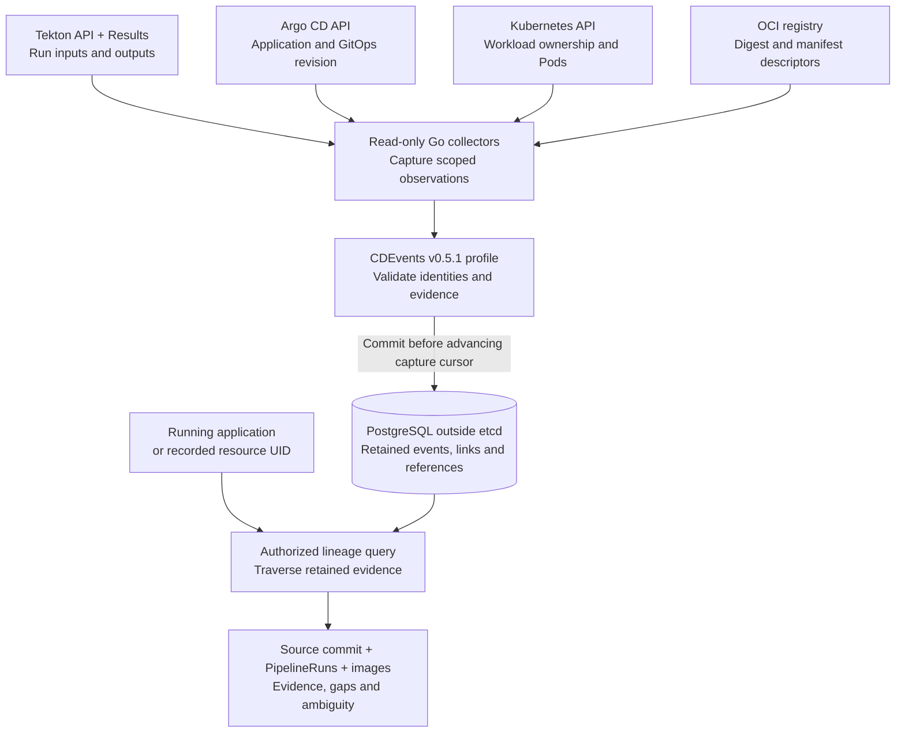

# ADR-0008: Tekton-to-Argo deployment lineage

## Context

> Given a running Kubernetes application, can we trace its image back to a source commit and the Tekton PipelineRuns that built it, even after those runs or earlier rollout resources are deleted?

To answer this after a run is deleted, we need to save its build details alongside the workload's image information.

Several runs can produce the same image. Without a promotion record naming the selected run, return the possible builds.

## Scope

Start with an optional OpenShift Pipelines integration that traces Tekton builds to Argo CD workloads. The first prototype follows Deployment ownership through ReplicaSets to Pods. Use saved checkout results and declared image outputs. Record which build was promoted.

Konflux integration and automated remediation or promotion are out of scope. This also excludes a new signing service or new core Tekton APIs/CRDs. Keep full artifacts and logs in their existing stores.

## Decision Drivers

Keep run details after pruning so a query can still reach the build's source commit. Store deployment history separately from the CI archive, with its own retention settings.

## Decision

Use CDEvents v0.5.1 with a versioned lineage profile. Prefer a separate Go collector/query service backed by PostgreSQL outside etcd. This projection stores the collected resource IDs and their relationships. Results keeps the CI archive; artifact content stays in OCI registries.

PostgreSQL lets us save an event and its links in one transaction, then query those relationships with SQL. Compare this service with an extension to Results using the same fixtures. That comparison needs to cover who owns the query API and how long each option keeps deployment history.

### Architectural Overview



Collectors validate the fields they read before saving them. The query service checks access before following the stored links. It shows the reported container image with its build and source details, or marks the missing link.

### Implementation Details

#### Capture-to-query process

| Step | Input and action | Retained output or failure |
| --- | --- | --- |
| 1. Capture | List/watch the scoped Tekton and Argo resources. Read the workload APIs and retained Results records as needed. Save the required OCI descriptors. | Save the UID/resourceVersion and the fields behind each link. Record when each watch started and its last saved position. Relisting after watch expiry only recovers resources that still exist. |
| 2. Normalize | Apply the configured checkout/output mappings. Keep the relationship type with each link. Validate events against the pinned schemas and profile. | Leave absent fields unknown. If no valid event can be formed, keep the allowed source fields separately and record why normalization stopped. |
| 3. Persist | Save source evidence and original event bytes in the same transaction as the JSONB view and currently known links. Only then acknowledge delivery or advance the capture checkpoint. | Keep the first receipt time for an identical retry. Reject conflicting bytes under an existing event ID; corrections need a new ID. |
| 4. Resolve/query | Start with a live workload UID or a previously saved UID. Follow only links the caller may read, with row/depth limits and cycle detection. | Show the running image per container. Keep candidate builds when promotion evidence is missing. Include the fields supporting each result and mark links that could not be made. |
| 5. Replay | Filter by when the event happened and by when the service learned about it. Apply these cutoffs to resolved links too. | Use only information available at the requested cutoff. A later resolution must not change an earlier answer. Replay needs the required evidence and resolution versions to remain stored; expired records leave gaps. |

These API reads happen at different times. Record when collection started and where it was interrupted. A backfill can use surviving resources or archives; it cannot recreate a Pod imageID or owner UID that was never saved. Keep the required history locally before upstream records expire.

#### Worked trace after pruning

```text
source repository S @ full commit A
  -> PipelineRun UID R, declared artifact repository/image @ digest D
  -> promotion evidence selects R/D for GitOps repository G @ commit B
  -> Argo Application UID U, captured apply evidence for Deployment UID W
  -> ReplicaSet UID X -> Pod UID O / container web
     requested image D; raw imageID I; resolved platform manifest M
     retained OCI descriptor path D -> M when D is an image index
```

After R is pruned, a query for W follows its current Pods and can still return A and R from the saved trace, while those links still match the Pods. Keep GitOps commit B separate from application source A. Missing promotion records leave candidate builds. A missing OCI descriptor path leaves the image relationship unresolved.

If X and O are later deleted, query saved O at its observation time using the archived UID chain. A current query follows the current Pod set; it must not reuse O's old image as the current answer.

#### Identities and evidence

| Relationship | Required evidence and limit |
| --- | --- |
| Pod/container to workload | Keep the registered cluster ID with the namespace UID, Pod UID and container name. Verify that the Pod controller ownerReference UID matches the ReplicaSet UID, then match its controller reference to the Deployment UID. Save the requested and reported image references with the imageID. Record the container state and observation time. Names or selectors alone cannot identify the same object after recreation. |
| Workload to Argo Application | Save the Application UID and its Argo installation/tracking settings. Bind the tracked resource to the observed workload UID; names alone cannot distinguish a recreated object. Argo tracking records management, not Kubernetes ownership. |
| GitOps revision to workload | Keep resolved revisions matched to their sources and render inputs. Save operation phase and the dry-run flag with per-resource results. Bind these to the observed workload UID/generation/template. Healthy/Synced or compared revision alone cannot attribute an old Pod to a commit; a missing binding leaves candidate revisions. |
| Image to build | Keep the repository-qualified algorithm/digest with each PipelineRun UID. Save the child TaskRun evidence by UID as well. Save declared outputs and run outcomes. More than one run can produce the same content. Equal digests do not select the run that caused deployment or show which registry served the image. |
| Build to application source | Use the configured checkout/input mapping to save the repository and resolved full commit. Resolver refSource identifies the Pipeline/Task definition, which may differ from the application checkout. Keep each input when there is more than one. |
| Promotion to GitOps change | Save the record naming the selected run and artifact, tied to the immutable GitOps commit or override change. A matching name or image alone cannot show which run was selected. |

Keep imageID exactly as reported by the runtime. It may not be a repository-qualified manifest digest. When a build publishes an OCI index but a Pod runs a platform manifest, save the verified descriptor path between them. Without it, leave that match unresolved. Report each container separately, including sidecars and Pods from different rollouts.

Argo status.sync.revision records a comparison. To tie it to a running Pod, save the applied workload UID/template with the operation results from that time. Successful history and tracking metadata alone do not supply that binding. For multi-source Applications, keep revisions matched to their source indexes and save render overrides. If the binding is missing, return candidate revisions.

#### Event profile and relationship language

Use customData for scoped resource references and the fields used to make each link. Include the actual checkout/build outputs and the GitOps inputs. Store per-container observations with pointers to the saved supporting values. schemaUri identifies the stricter profile schema. Map the producer's fields explicitly; a familiar parameter name does not prove which source was checked out or which image was built.

```text
CDEvent {
  context: {specversion, source, id, type, timestamp, schemaUri,
            chainId?, links?}
  subject: {id, source?, content}
  customData: {resourceRefs, inputs, outputs, gitops, containers, evidence}
}
```

Register each cluster under a stable administrator-assigned ID, independent of its API address. A replacement cluster gets a new ID. Bind namespaces to tenants using trusted configuration and the namespace UID. Keep event IDs stable across retries. IDs must be unique across producers within a tenant so unqualified link targets have one answer. Reject collisions and leave missing targets unresolved.

CDEvents links reference event context IDs. PATH.from records progression from the preceding event to the containing event. In this profile, RELATION/TRIGGER targets the event that caused the current event. RELATION/ARTIFACT points from an execution/deployment event to an artifact event. Keep Kubernetes ownership and Argo management as separately typed evidence. chainId groups events; it does not establish causality or prove the chain is complete. Evidence record IDs and Kubernetes UIDs are not context-link targets.

Pin envelope validation separately from the event types and lineage profile. Use context.specversion 0.5.1 from the released fixtures. Event-type versions are separate. The pinned spec still contains older specversion prose; resolve that mismatch in conformance checks before production use.

> RFC 3339 defines the timestamp format for query cutoffs. It does not synchronize clocks or establish causality.

> RFC 6901 defines JSON Pointers. Use them to identify the saved field behind a relationship.

#### PostgreSQL storage

```text
events(tenant, source, id, event_time timestamptz,
       received_at timestamptz, raw bytea, payload jsonb)
links(tenant, from_source, from_id, target_id, target_source?,
      type, kind, known_at timestamptz)
```

Key events by tenant/source/id, with IDs unique across producers within a tenant. Keep accepted event bytes in BYTEA and a queryable copy in JSONB. Saved source evidence needs its own storage alongside these event/link tables. Keep unresolved targets and record when a link was resolved or expired. Filter known_at by the query's knowledge cutoff so a later resolution cannot change an earlier answer. Use the source timestamp when known; otherwise label the collector's observation time. Deleted evidence leaves the query incomplete.

Use B-tree indexes for event identities and link endpoints. Add indexes for the time filters. Use GIN where JSONB filtering needs it, and limit recursive queries. No PostgreSQL extension is required. Optional pg_stat_statements needs preloading to measure queries. Measure query time and stored data size in the prototypes, then test how long a restore takes.

## Considered Options

### Placement

| Option | Pros | Cons and reason |
| --- | --- | --- |
| Separate PostgreSQL projection (preferred) | Deployment history gets its own retention policy. Save evidence byte-for-byte and change the query rules without changing the CI archive. | Adds a service/database to operate, including migrations. Collection can lag, and some CI identity indexes are duplicated. Keeps deployment history separate from CI pruning. |
| Extend Tekton Results | Reuse the archive APIs and namespace authorization. Generic JSON Records can carry the extra data. | Still needs Argo/runtime collection and history queries, with a CD retention policy. Direct JSONB storage loses original serialization. Compare encoded original bytes or durable external pointers under the deployed API-size and parent-retention limits, using the same fixtures. |
| Live API query / do nothing | No new history service or database. | Can only query records that remain available. It cannot reconstruct required details that were never captured before deletion. |

### Storage backend

| Option | Pros | Cons and reason |
| --- | --- | --- |
| PostgreSQL (chosen) | Save events and links transactionally. Query JSONB alongside the original BYTEA data, using row security and recursive SQL without a graph extension. | Needs versioned migrations and tested backup/restore procedures. Set traversal limits from query measurements. |
| SQLite | Small local setup; already used by the offline PoC. | The PoC uses one connection. Shared multi-tenant operation and HA have not been tested, nor has recovery. Keep it for local experiments. |
| Graph database, e.g. Neo4j | Represents relationships directly and provides path queries. | Adds another backend to operate, with its own permissions and retention setup. Compare it with PostgreSQL before choosing it for query performance. |

## Consequences

An operator can follow a captured container image back to candidate builds after the original runs are deleted. The separate service keeps deployment history for as long as that installation needs, while referring to CI records in Results.

The service adds another component to run. Its view can lag behind the source APIs, and missed captures leave holes in the history. Adapters must be updated when source fields or event schemas change. An unsigned claim cannot authenticate a build. Missing promotion receipts or unsupported runtime IDs can prevent a complete trace, as can expired evidence.

## Dependencies

Check the profile against the deployed versions of Tekton and Argo CD, including the Kubernetes fields they report. Check Results compatibility and the PostgreSQL version too. TEPs 0192 and 0193 propose artifact metadata and OCI storage. They are possible future inputs, not prerequisites for this ADR.

## Security & Compliance

Give collectors scoped read access to the source APIs. They do not need Secret access or deployment write permissions. Accept only approved evidence fields. Authenticate ingestion and obtain tenant/cluster identity from trusted configuration. Authorize each referenced namespace, including saved identities for namespaces that have since been deleted or recreated.

Apply tenant-scoped row security to events and links, including their saved evidence. The service's database roles must not own the tables. They must also lack SUPERUSER and BYPASSRLS. A shared digest must not reveal another tenant's builds. Historical queries use the caller's current permissions.

A CDEvent or API status field alone does not prove who built an image. Keep original signed bytes if verification needs them and policy permits storing them. A redacted or reserialized copy cannot replace those bytes. If they cannot be kept, report verification as unavailable.

## Compatibility & Migration

Make collection opt-in. Backfill only records that are still available. Existing pipelines keep working; a complete trace needs configured checkout/output mappings and may need extra producer results. Roll back by stopping collection and query access, without changing Tekton or Argo reconciliation. Keep the database for inspection and version its schema migrations. Restore procedures must handle those schema versions.

## Operational Readiness

The Pipelines integration team could maintain the collectors and query service, including the event profile and schema. The installation owner would operate PostgreSQL and set data retention. Confirm who handles backups and recovery before accepting the design. Watch capture lag and failed validation. Track unresolved links alongside query limits, and test restores. Coordinate retention with the registry and Results so required records remain available.

Kubernetes keeps a limited number of old ReplicaSets. Argo CD has its own history limit, and Results has a separate retention policy. The Results watcher can allow requested deletion when its finalizer storage deadline expires, even if storage was not confirmed. Copy the needed details before those records disappear. Mark the query incomplete when required records have expired.

## Testability

| Scenario | Required result |
| --- | --- |
| Capture runs/pods/replica sets, prune then query | The saved UID chain still answers the historical query without those live objects. |
| Start collection with no saved state, then test watch expiry. Also cover an outage while records are being pruned. | Show where capture stopped or history is unavailable. Do not invent the missing records. |
| Use the same name with a new UID or leave build/promotion evidence ambiguous. | Keep the UID histories separate. Return candidate builds when promotion evidence is missing. |
| Test multiple containers/replicas. Test multi-source Argo and OCI index/platform differences. | Keep each container observation and match revisions to source indexes. Require a verified OCI descriptor path or leave the image match unresolved/unsupported. |
| Duplicate or conflicting IDs, out-of-order links, cycles and resolution in later periods | Identical retries change nothing. Reject conflicts. Limit traversal and keep late resolution out of earlier replay results. |
| Test tenant isolation. Check queries after retention expiry and after a backup restore. | Hide unauthorized records. Mark expired evidence as missing; restored queries reproduce answers for the period whose evidence and resolution history remain stored. |

## PoCs

The public capture PoC reads build and deployment details. The SQLite PoC replays synthetic history. Neither implements this CDEvents profile or validates PostgreSQL. They also do not establish authenticated provenance for the captured workloads or resolve every runtime imageID format.

## Acceptance Criteria

| Gate | Required evidence and stage |
| --- | --- |
| Contract and reviewer agreement | Agree on cluster/tenant identity with security reviewers. Pipeline/Results and Argo reviewers must check the producer mappings and promotion evidence. Confirm the profile validation rules and unsupported cases. Name the reviewers and implementation owners. |
| Placement comparison | Run the same focused fixtures against a Results-extension prototype and the separate PostgreSQL service before ADR acceptance. Compare API/storage changes and authorization. Record the retention settings and who operates each option. |
| Correctness | Before calling the implementation supported, show the worked trace after deletion and run every Testability case, including missing evidence and dual-time replay. |
| Operational feasibility | Before supported rollout, measure ingestion and query behavior on the deployed versions. Check retention capacity. Test schema migration/rollback and backup/restore. |

## References

For layout examples, see the Q4 2026 PipelineRun-dependencies and credential-service proposals below.

- [ADR process and product/upstream scope](./0001-adopt-adrs.md).
- [PipelineRun dependencies proposal #14](https://github.com/chmouel/osp-architecture/blob/c8cccdf532ff0571c616a58f69b29869e1e9dcec/ADR/0003-pipelinerun-dependencies.md) and [credential-service proposal #17](https://github.com/chmouel/osp-architecture/blob/32e5771fa8d384f2a7be64860080650605d3c4bf/ADR/0003-github-credential-service.md).
- [CDEvents v0.5.1 specification](https://github.com/cdevents/spec/blob/df02ce0b6563a13bf35cc109993b03b18da8a14a/spec.md), [event links](https://github.com/cdevents/spec/blob/df02ce0b6563a13bf35cc109993b03b18da8a14a/links.md), [CI events](https://github.com/cdevents/spec/blob/df02ce0b6563a13bf35cc109993b03b18da8a14a/continuous-integration.md) and [deployment events](https://github.com/cdevents/spec/blob/df02ce0b6563a13bf35cc109993b03b18da8a14a/continuous-deployment.md).
- [Argo Application fields](https://github.com/argoproj/argo-cd/blob/7cbfbe9b3677e33f8bd500797fb4ea10bed047b5/pkg/apis/application/v1alpha1/types.go), [tracking](https://github.com/argoproj/argo-cd/blob/7cbfbe9b3677e33f8bd500797fb4ea10bed047b5/docs/user-guide/resource_tracking.md) and [multiple sources](https://github.com/argoproj/argo-cd/blob/7cbfbe9b3677e33f8bd500797fb4ea10bed047b5/docs/user-guide/multiple_sources.md).
- [Tekton PipelineRun](https://github.com/tektoncd/pipeline/blob/3449daa318e7868447688b4dfbc6ab4e5c838d3c/pkg/apis/pipeline/v1/pipelinerun_types.go), [TaskRun](https://github.com/tektoncd/pipeline/blob/3449daa318e7868447688b4dfbc6ab4e5c838d3c/pkg/apis/pipeline/v1/taskrun_types.go), [resolver provenance](https://github.com/tektoncd/pipeline/blob/3449daa318e7868447688b4dfbc6ab4e5c838d3c/pkg/apis/pipeline/v1/provenance.go) and [checkout commit result](https://github.com/tektoncd/catalog/blob/ee409b23543881457c2f35cbd630ea55732b1856/task/git-clone/0.9/git-clone.yaml).
- [Kubernetes ownership fields](https://github.com/kubernetes/apimachinery/blob/398326f9ce6a1007d932b935b675435d6f5e1ad2/pkg/apis/meta/v1/types.go), [container status](https://github.com/kubernetes/api/blob/a2c84304d35fb510370c5281c8e3a2234cc81e46/core/v1/types.go) and [watch history](https://github.com/kubernetes/website/blob/542bad2ab92dd6ee7916b2b916d84cda64c77f6c/content/en/docs/reference/using-api/api-concepts.md).
- [OCI image indexes](https://github.com/opencontainers/image-spec/blob/4feed4a6674e59d301b9294f187ac46acb2de99f/image-index.md).
- [Results watcher/deletion](https://github.com/tektoncd/results/blob/9d8626118d5582ae95b28107afbdd5b6ba551c9c/docs/watcher/README.md), [retention](https://github.com/tektoncd/results/blob/9d8626118d5582ae95b28107afbdd5b6ba551c9c/docs/retention-policy-agent/README.md) and [Record storage](https://github.com/tektoncd/results/blob/9d8626118d5582ae95b28107afbdd5b6ba551c9c/pkg/api/server/db/model.go).
- PostgreSQL: [JSONB](https://www.postgresql.org/docs/current/datatype-json.html), [binary data](https://www.postgresql.org/docs/current/datatype-binary.html), [recursive SQL](https://www.postgresql.org/docs/current/queries-with.html), [row security](https://www.postgresql.org/docs/current/ddl-rowsecurity.html), [pg_stat_statements](https://www.postgresql.org/docs/current/pgstatstatements.html).
- [RFC 3339](https://www.rfc-editor.org/rfc/rfc3339) and [RFC 6901](https://www.rfc-editor.org/rfc/rfc6901).
- Proposed [TEP-0192](https://github.com/tektoncd/community/pull/1298) and [TEP-0193](https://github.com/tektoncd/community/pull/1301); [Results API TEP](https://github.com/tektoncd/community/blob/main/teps/0021-results-api.md).
- Historical [capture PoC](https://github.com/waveywaves/release-trace/blob/b4adc1ac60a4a9b5bba2070cdf8e0656134ab7a7/docs/collector.md) and [offline history PoC](https://github.com/waveywaves/release-trace/blob/b4adc1ac60a4a9b5bba2070cdf8e0656134ab7a7/docs/offline.md).

## Change Log

| Date | Author | Change Summary |
| --- | --- | --- |
| 2026-11-18 | @waveywaves | Initial proposed Tekton/Argo lineage ADR. |
| 2026-11-19 | @waveywaves | Adopted CDEvents and outlined PostgreSQL storage. |
| 2026-11-20 | @waveywaves | Expanded the central question, end-to-end process, architecture diagram, alternatives and acceptance evidence after review feedback. |
